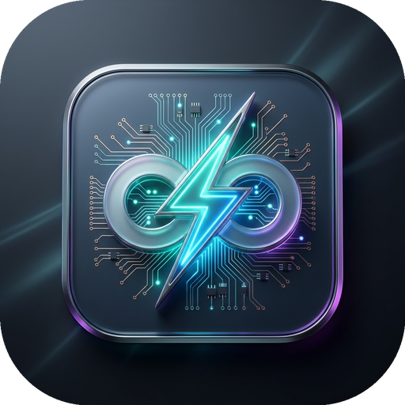

# ⚡ Arduino Universal Hub (萬能硬體控制中樞)

<p align="center">
  
</p>

<p align="center">
  <b>全方位、模組化、跨設備、即時雙向連線的 Arduino 萬能硬體控制系統</b><br>
  整合 Desktop GUI + 高效能 Web Console + Cloudflare 內網穿透 + Web Serial API + 脫機獨立韌體自動生成燒錄
</p>

---

## 🌟 核心特色

### 1. 🖥️ 雙端控制面板與多裝置即時同步
- **桌面端 (Desktop GUI)**：基於 Python Tkinter，支援深色現代化主題、全自動熱拔插偵測、毫秒級指令收發與安全保護。
- **網頁端 (Web Console)**：基於 Waitress + Flask，支援多裝置（手機、平板、其他電腦）同時連線，具有 SSE (Server-Sent Events) + 自適應雙向同步引擎。
- **🌐 跨網遠端存取**：內建 Cloudflare Tunnel 自動穿透，無需固定公網 IP 或路由器設定 Port Forwarding，即可從外網任何地點連線操控。
- **⚡ 瀏覽器 Web Serial API**：支援在純前端環境下透過 Chrome/Edge 瀏覽器直接存取本機 USB Arduino。

### 2. ✨ 雙 RGB LED 18 款炫彩即時連線特效
- 同步彩虹流轉 (`sync_rainbow`)、交替冷暖呼吸 (`alt_breathing`)、警車紅藍爆閃 (`police_strobe`)、賽博龐克呼吸 (`cyberpunk`) 等 18 款即時演算法特效。
- 支援共陽 (Common Anode) / 共陰 (Common Cathode) 硬體自適應與軟體色彩校正。

### 3. 🔲 MAX7219 8x8 點陣圖形與跑馬燈系統
- 互動式 8x8 LED 矩陣畫布，點選即時同步顯示至硬體。
- 內建字元庫，支援自訂文字跑馬燈流暢滾動（可即時調節滾動速度與循環模式）。
- 內建 10+ 組動態動畫（心跳搏動、圓圈擴散、吃豆人動畫、星光閃爍等）。

### 4. 🎭 自訂流程中樞 (Sequencer) 與一鍵脫機燒錄
- 視覺化排程：可將 RGB 特效、點陣動畫、跑馬燈文字、舵機角度、開關動作、PWM 調光與延遲時間編排成自訂工作流程。
- 單步即時測試：支援點擊任意步驟即時發送至硬體驗證。
- **一鍵脫機燒錄 (Standalone Firmware Flash)**：自動將您編排的自訂流程轉譯為完全獨立的純 C++ Arduino `.ino` 韌體，自動編譯並直接燒錄至晶片，拔掉電腦 USB 線後由行動電源供電仍可獨立運作！

### 5. 🛠️ 廣泛的感測器與執行器模組庫
- 數位開關 (繼電器、LED、電磁閥)
- PWM 調光 / 馬達調速
- SG90 / MG995 伺服舵機控制 (0°~180°)
- 類比/數位感測器連續即時串流監控 (ADC / 狀態圖表)
- HC-SR04 超音波即時測距

---

## 📂 專案檔案結構

```
ArduinoUniversalHub/
├── universal_gui.py             # 核心桌面端控制應用 (Tkinter 主程式)
├── universal_web.py             # 核心 Web 伺服器 (Flask + Waitress WSGI)
├── cloudflare_tunnel.py         # Cloudflare Tunnel 穿透管理模組
├── standalone_generator.py      # 自訂流程脫機獨立 C++ 韌體轉譯引擎
├── standalone_flash_optimizer.py# Arduino-CLI 燒錄與編譯整合工具
├── default_profile.json         # 預設配件與示範流程設定檔
├── web/
│   └── index.html               # 現代化單頁 Web 儀表板 (SSE + 響應式佈局)
├── universal_firmware/
│   └── universal_firmware.ino   # Arduino 主控韌體 (高波特率 115200 序列協定)
├── standalone_sketch/           # 生成的脫機獨立韌體工作區
├── run_gui.bat                  # 快速啟動桌面端控制中心
└── README.md                    # 專案詳細說明文件
```

---

## 🚀 快速開始

### 環境需求
- Python 3.10+
- 安裝依賴套件：
```bash
pip install pyserial flask waitress
```
- Arduino Uno 開發板 (使用 USB 線連接至電腦)

### 啟動方式

#### 方式 A：啟動桌面萬能控制中心 (推薦)
雙擊執行 `啟動萬能控制中心.bat` 或在終端機執行：
```powershell
python universal_gui.py
```
* 程式會自動偵測 Arduino COM 埠並完成握手連線。
* 同時在背景啟動 Web 服務與 Cloudflare 穿透網址。
* 點擊上方 **「📱 跨電腦同步」** 即可取得內網及外網存取網址，讓手機或不同電腦直接加入控制！

#### 方式 B：單獨啟動 Web 伺服器
```powershell
python universal_web.py
```
開啟瀏覽器訪問 `http://127.0.0.1:5000` 即可使用 Web 介面。

---

## 📱 跨電腦 / 手機同步操控架構

1. **主控電腦 (已插 Arduino)**：
   - 執行 `universal_gui.py`，保持連線即可。
2. **其他裝置 (手機、平板、其他電腦)**：
   - **無需安裝 Python、無需插 USB**。
   - 直接用瀏覽器開啟主控電腦提供的網址（例如同一 Wi-Fi 下的 `http://192.168.1.xxx:5000` 或 Cloudflare 網址）。
   - 所有裝置上操作的開關、滑桿、顏色與特效均會在毫秒內全域雙向同步！

---

## 📄 授權條款
MIT License
